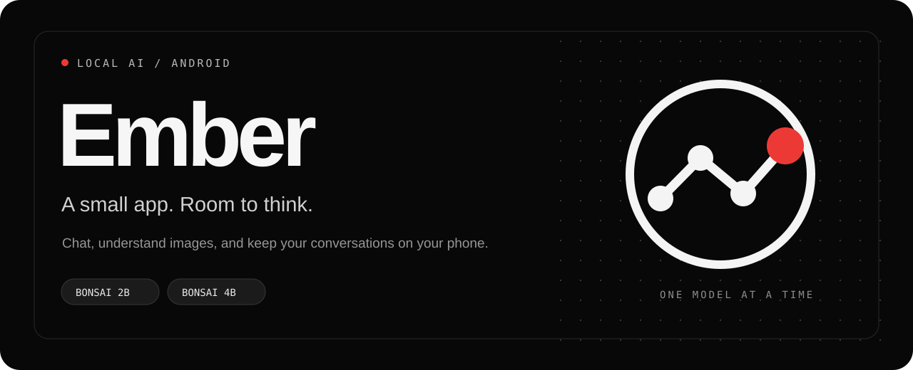

  
  
  
  

<strong>Local chat. Named code files. An inline canvas.</strong> Liquid AI's LFM3 and PrismML's Bonsai models, running on your phone.

Ember is a personal Android AI app built with Jetpack Compose and Material 3. Choose a compact model, download it directly from its publisher, and load it when you want to chat. Responses are generated on your device using the CPU.

The interface uses a restrained black, white and red palette, dot-matrix lettering, a conversation drawer and small tactile interactions. It uses static surfaces rather than background blur or continuous decorative animation.

> **Development update.** This checkout adds LFM3, named file downloads and Canvas. The linked public v0.1.0 APK contains the earlier Bonsai feature set; build this checkout for the new features. Device checks and remaining limits are described in [Build Ember](docs/BUILDING.md).

Version 0.2.1 fixes empty LFM3 code replies, adds retry and Canvas repair actions, and matches app panels to the selected theme. See the [changelog](CHANGELOG.md) and [reliability audit](docs/AUDIT-0.2.1.md) for validation and model-quality limits.

## Start in a minute

1. Download **[Ember-0.1.0-arm64.apk](https://github.com/EruditeCoder108/LocalAIapp/releases/download/v0.1.0/Ember-0.1.0-arm64.apk)** and install it on a compatible Android phone.
2. Open Ember. Start with **Bonsai 2B**, or tap the model name to select **4B**.
3. Tap **Download**. Keep Ember open; downloads pause when it leaves the foreground. Tap Download again to resume.
4. Once the file has been verified, tap **Load model** and send a message.
5. For photos, unload the model, open the model selector and download its optional **image support**. Then reload and use **+ → Attach image**.

Already have the exact supported files? You can import them through Android's file picker instead. No account or API key is required for local chat.

## Models, your choice

| | Bonsai 2B | Bonsai 4B |
|---|---|---|
| Role | Lighter starting option | Larger chat option |
| Text download | **517 MB** | **1.15 GB** |
| Optional image support | 365 MB | 367 MB |
| Publisher | [PrismML · 2B](https://huggingface.co/prism-ml/Ternary-Bonsai-2-2B-gguf) | [PrismML · 4B](https://huggingface.co/prism-ml/Ternary-Bonsai-2-4B-gguf) |

Sizes are rounded decimal download sizes, **not RAM requirements**. All four files together occupy about 2.40 GB. Model weights are not bundled in this repository or APK. Downloads use pinned publisher revisions and must match the expected length and SHA-256 before activation.

**Liquid LFM3-1.7B** is a text-only option using the publisher's QAD Q4_0 checkpoint, a **1.05 GB** download. It uses its own pinned upstream llama.cpp library; Bonsai retains the PrismML runtime required by PQ2_0. The picker also retains the optional **Qwen3.5 Heretic 2B** model from the earlier personal build (1.31 GB text, 668 MB image support), so existing downloaded files and model selections remain usable.

Only one language model is loaded at a time. Switching unloads the previous model first; stop an ongoing reply before switching. The answering model is recorded with each response.

## What Ember does today

| Feature | How it works |
|---|---|
| **Local conversations** | Streaming replies, saved chat history and a searchable left drawer. Long replies follow the latest text until you scroll up. |
| **Image understanding** | A separate, optional projector processes photos locally. The projector is released before text generation. |
| **Explicit memory** | Save facts in Settings → Memory or type “Remember that …”. Facts persist across chats; retrieval currently uses word matching. |
| **Optional web search** | **+ → Search web** sends that question to DuckDuckGo and gives the local model up to four result snippets. Source links appear beneath the reply. |
| **Real file exports** | Save completed replies as PDF, HTML, Markdown, text, or their first fenced code block using Android's document picker. |
| **Named code files** | Code responses appear as file pills such as `button.html` or `styles.css`. The download button saves the actual source to `Downloads/Ember` on Android 10+, with no format-selection menu or document wrapper. Android 9 uses the document picker. |
| **Inline Canvas** | Enable **+ → Canvas** for an inline HTML/CSS/SVG preview, including browser JavaScript. Tap a file to inspect or edit its source and expand the preview. Other programming languages remain downloadable files. |
| **Simple controls** | Load/unload, response length, CPU thread count, and system/light/dark appearance. |

Chat, image input, memory and export work offline after the necessary downloads. Web search is explicitly selected per message and requires internet. The free search endpoint can change, rate-limit requests or return a CAPTCHA; Ember reports those failures.

Canvas runs web code in a sandboxed iframe inside WebView. Network requests, device permissions, native bridges and file/content access are blocked. Use self-contained pages; remote fonts, CDNs, package installation, Python and Node execution are unsupported. Preview edits affect the current preview and download, not the saved conversation's original source. When a script fails, **Fix with Ember** attaches the current source and error to a new correction request; this action requires a loaded model and does not guarantee a correct repair. The app name and empty-state wordmark both read **Ember**.

## Storage, memory and privacy

- Conversations, saved facts and copied image attachments are stored in the app's private Android storage.
- No cloud LLM, account system, advertising SDK or analytics SDK is included.
- Model downloads connect to Hugging Face and its file-serving infrastructure. Optional searches send the current question to DuckDuckGo. Opening source links launches an external browser.
- Downloading a model does not load it into RAM. Use **Unload** to release its loaded inference state.
- Leaving the app requests cancellation of generation, search and downloads. Loaded weights may remain cached until Unload, activity disposal or process death; there is no automatic idle-unload timer yet.
- No background inference service, always-listening microphone or boot receiver is included.
- Android backup/device transfer is disabled. Uninstalling removes the app's local data and downloaded models.

## Clear limits

Ember can generate incorrect answers. A source number is not a guarantee that a claim is supported. Image input is resized and token-limited; dense text and small details can be missed. PDF export uses basic text layout.

Semantic memory, automatic recall of old conversations, Python execution, autonomous tools and phone control are **not shipped features**. The active context is 4,096 tokens. Bonsai requests thinking off; LFM3 uses its reasoning template, bounds hidden reasoning separately (32 tokens for short answers, 128 for long/code answers), and streams only the parsed answer. Code requests and follow-up edits get up to 2,048 answer tokens whether Canvas is enabled or not; ordinary answers use the response-length preference. Large files can still reach the limit. Failed and interrupted turns stay visible in chat but are excluded from future model context. The latest unsuccessful reply has a **Try again** action. Canvas surfaces script errors, but a completed file is not a guarantee that model-written code is correct. See [VISION.md](VISION.md) for future directions.

## Build and contribute

The application uses Kotlin, Compose/Material 3, JNI, a pinned PrismML fork of llama.cpp for Bonsai, and a separate pinned upstream llama.cpp library for LFM3. JNI-only exports isolate the two runtimes. The Prism fork is required for the selected PQ2_0 files.

**[Build instructions →](docs/BUILDING.md)** · **[Future direction →](VISION.md)** · **[Third-party notices →](licenses/)** · **[Report an issue →](https://github.com/EruditeCoder108/LocalAIapp/issues)**

Issues are useful when they include the device/Android version, selected model, reproduction steps and a sanitized error message. Please keep personal conversations, photos and credentials out of public reports.

## Credits and license

Created by **[EruditeCoder108](https://github.com/EruditeCoder108)**. Independent project; not affiliated with PrismML, Qwen, Google or Nothing.

Application source: [MIT](LICENSE). Bonsai weights: [Apache 2.0](licenses/model-LICENSE.txt), with [PrismML/Qwen notices](licenses/model-NOTICE.txt). LFM3 weights: [LFM Open License v1.0](licenses/liquid-model-LICENSE.txt), with [Liquid AI attribution and pinned artifact details](licenses/liquid-model-NOTICE.txt). llama.cpp and jsoup: MIT. Geist: SIL Open Font License. The app's abstract logo was generated with AI during development; the README illustration is repository-native SVG artwork.
